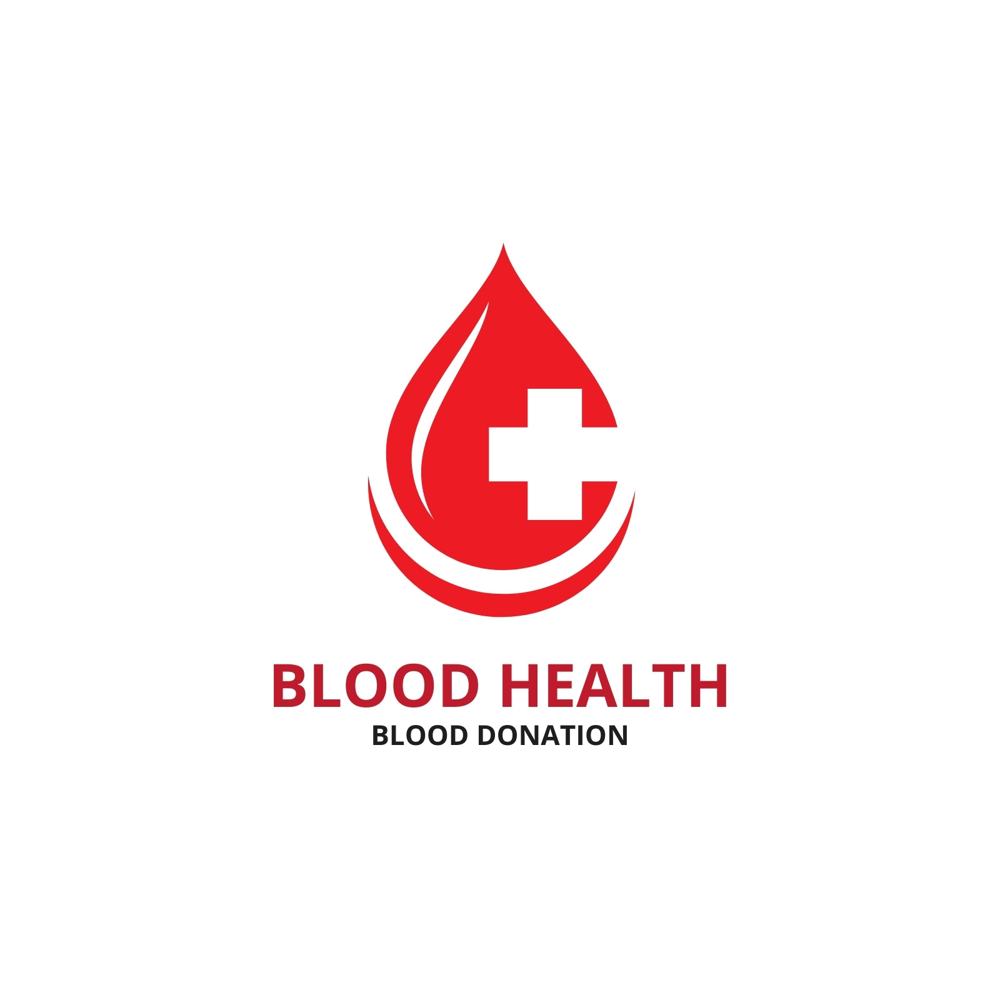

# 🩸 BloodLink — Blood Donation & Emergency Coordination Platform

<div align="center">
  
  <h2>Every Drop Connects a Life</h2>
  <p>An enterprise-grade, life-saving healthcare web application connecting voluntary blood donors, emergency patients, blood banks, and verified organizations across Bangladesh with automated dispatch, real-time tracking, and bKash financial support.</p>

  <p align="center">
    <a href="https://bloodlink-frontend.vercel.app"></a>
    <a href="https://blood-link-backend-one.vercel.app/api/v1"></a>
    <a href="https://github.com/mdratul4505/BloodLink-Frontend"></a>
    <a href="https://github.com/mdratul4505/BloodLink-backend"></a>
  </p>
</div>

---

## 🌐 Quick Links & Deployments

| Resource | URL | Description |
|---|---|---|
| 🚀 **Frontend Live URL** | [https://bloodlink-frontend.vercel.app](https://bloodlink-frontend.vercel.app) | Live Production Web Application |
| ⚡ **Backend Live API** | [https://blood-link-backend-one.vercel.app/api/v1](https://blood-link-backend-one.vercel.app/api/v1) | Production RESTful API on Vercel |
| 🩺 **Backend Health Check** | [https://blood-link-backend-one.vercel.app/health](https://blood-link-backend-one.vercel.app/health) | API Server Health Status |
| 💻 **Frontend Repository** | [https://github.com/mdratul4505/BloodLink-Frontend](https://github.com/mdratul4505/BloodLink-Frontend) | Next.js 16 Client Source Code |
| ⚙️ **Backend Repository** | [https://github.com/mdratul4505/BloodLink-backend](https://github.com/mdratul4505/BloodLink-backend) | Express 5 + Prisma 7 Server Code |

---

## 🔑 Test Accounts & Demo Credentials

| Role | Email | Password | Access Capabilities |
|---|---|---|---|
| **Platform Super Admin** | `admin@bloodlink.org` | `Admin@123456` | Overview stats, user suspension/activation, organization approvals, request management, audit logs |
| **Organization Account** | `org@redcrescent.org` | `Org@123456` | Donation camp creation, blood drive management, donor registration roster |
| **Standard User / Donor** | `donor@bloodlink.org` | `Donor@123456` | Post emergency blood requests, respond to donate, toggle availability, view receipts |

---

## 🌟 Platform Overview & Key Features

**BloodLink** bridges the critical time gap between blood donors and patients facing medical emergencies, surgeries, thalassemia, or dengue crises across all **8 Divisions and 64 Districts of Bangladesh**.

### 1. 🚨 Emergency Blood Request Workflow
- **Date Protection**: The requested date (`neededBy`) is strictly restricted to **today or future dates**; past dates are blocked on both UI and backend.
- **Bangladesh Geolocation Engine**: Dynamic cascading dropdowns for 8 Divisions (Dhaka, Chattogram, Rajshahi, Khulna, Barishal, Sylhet, Rangpur, Mymensingh) and 64 Districts with manual Upazila specification.
- **Urgency Levels**: Visual indicators for `NORMAL`, `URGENT` (within 24 hours), and `CRITICAL` (immediate surgery/emergency) with pulsing alerts.
- **Global SOS Launcher**: Persistent Floating Action Button (FAB) for 1-click emergency blood broadcast from any page.

### 2. 🩸 Smart Donor Coordination & 6-Month Recovery Rule
- **Mandatory Contact Number**: When a donor responds to donate, a required mobile phone number field ensures the requester can immediately call them.
- **Direct 1-Click Call Button**: Donor response cards display a prominent, clickable `tel:` button for immediate communication.
- **6-Month Donor Safety Guard**: Donors who have donated within the last 6 months are automatically excluded from donor search listings until their recovery period elapses.
- **Approve & Auto-Fulfill**: Once the requester clicks **"Approve & Confirm Donor"**, the request status automatically updates to `FULFILLED`, instantly removing it from the public requests directory and Home Page.

### 3. 🏢 Organization & Blood Bank Verification
- **User-to-Organization Application**: Users can apply from their dashboard (`/dashboard/user/apply-organization`) with registration numbers and establishment documents.
- **Admin Review System**: Administrators review pending applications with 1-click approval that instantly elevates the user role to `ORGANIZATION`.
- **Donation Camps Management**: Organizations create and manage public blood donation camps with real-time donor registration tracking.

### 4. 💳 bKash Payment Gateway Integration
- **Voluntary Contributions**: bKash Tokenized Checkout for platform operations and patient emergency funds.
- **Fail-Safe Callback & Verification**: Instant transaction verification with bKash API without "Transaction Not Found" errors, providing printable receipts and transaction IDs (`trxID`).

### 5. 🔐 Enterprise Authentication & Security
- **Email OTP Verification**: 6-digit numeric OTP sent via Nodemailer Gmail SMTP for registration, login verification, and password resets.
- **Dual JWT Tokens**: Access Token (1 Day) + Refresh Token (7 Days) with automated token rotation and logout blacklisting.
- **Google OAuth Integration**: One-click Google sign-in with server-side token verification.

### 6. 🌐 Modern UI/UX, Themes & Localization
- **shadcn/ui & Tailwind CSS**: Accessible, clean interface with sleek micro-interactions.
- **Dark & Light Mode**: Instant toggle between Light, Dark, and System Default themes.
- **Bilingual Support**: Full English and বাংলা (Bengali) language toggle with persistent state.

---

## 🛠️ Technology Stack

### Frontend Architecture
- **Framework**: Next.js 16.4 (App Router, Server & Client Components)
- **Library**: React 19
- **Language**: TypeScript 5.x
- **Component Suite**: [shadcn/ui](https://ui.shadcn.com/) (Radix UI primitives)
- **Styling**: Tailwind CSS with CSS Variables design tokens
- **Data Fetching**: TanStack React Query v5
- **HTTP Client**: Axios with automated token refresh interceptors
- **Icons**: Lucide React
- **Animations**: Motion for React (`motion/react`)

### Backend Architecture
- **Runtime**: Bun / Node.js 20+
- **Server Framework**: Express 5.x
- **Database & ORM**: PostgreSQL via Prisma ORM 7
- **In-Memory Cache**: Redis (ioredis) with automatic fallback
- **Authentication**: JWT, bcryptjs, google-auth-library
- **Email Delivery**: Nodemailer with Gmail SMTP
- **Payment Gateway**: bKash Tokenized Checkout API v1.2

---

## 📂 Project Directory Structure

```
blood-link-frontend/
├── src/
│   ├── app/
│   │   ├── (auth)/                  # Login, Register, Forgot/Reset Password, OTP Verification
│   │   ├── (public)/                # Home Page, Blood Requests, Donors, Camps, Organizations, Developer
│   │   ├── dashboard/
│   │   │   ├── user/                # Donor availability, requests, responses, apply organization
│   │   │   ├── organization/        # Camps, profiles, donor registrations
│   │   │   └── admin/               # System stats, users, verify orgs, audit logs, payments
│   │   ├── payment/
│   │   │   ├── callback/            # bKash callback handler & digital receipt
│   │   │   ├── success/             # Success redirect page
│   │   │   └── failed/              # Failed transaction page
│   │   ├── layout.tsx               # Root layout with providers & SOS floating button
│   │   └── globals.css              # Theme CSS variables & design tokens
│   ├── components/
│   │   ├── home/                    # 10 modular landing page sections
│   │   ├── dashboard/               # AppSidebar, DashboardHeader, NavNotifications
│   │   ├── layout/                  # Navbar, Footer
│   │   └── ui/                      # Official shadcn/ui components
│   ├── constants/
│   │   └── bangladesh-locations.ts  # 8 Divisions and 64 Districts database
│   ├── providers/                   # Auth, Language, Theme, and Query providers
│   ├── services/                    # Typed API client services
│   └── types/                       # TypeScript interfaces and enum models
```

---

## ⚙️ Local Development Setup

### 1. Clone the repositories
```bash
# Clone Frontend
git clone https://github.com/mdratul4505/BloodLink-Frontend.git
cd BloodLink-Frontend

# Install dependencies
bun install
# or: npm install
```

### 2. Configure Environment Variables
Create a `.env.local` file in the root directory:
```env
NEXT_PUBLIC_API_BASE_URL=https://blood-link-backend-one.vercel.app/api/v1
NEXT_PUBLIC_GOOGLE_CLIENT_ID=137918537073-dibo6v1hnvcm0m906e8nnh788akcru88.apps.googleusercontent.com
```

### 3. Start Development Server
```bash
bun run dev
# or: npm run dev
```
Open [http://localhost:3000](http://localhost:3000) to view the application.

### 4. Build for Production
```bash
bun run build
# or: npm run build
```

---

## 📄 License & Attribution

Developed with ❤️ for humanity by **MD. Ratul Hasan**.  
*Every Drop Connects a Life.*
